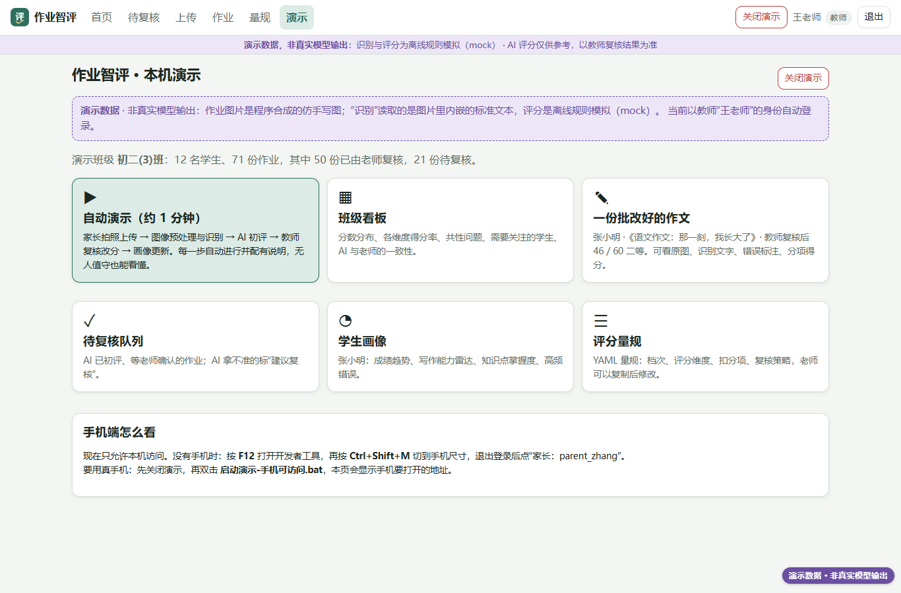
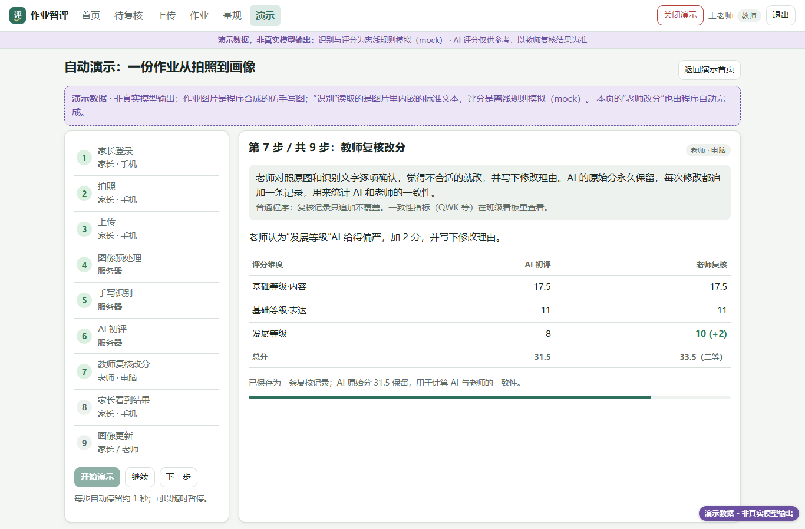
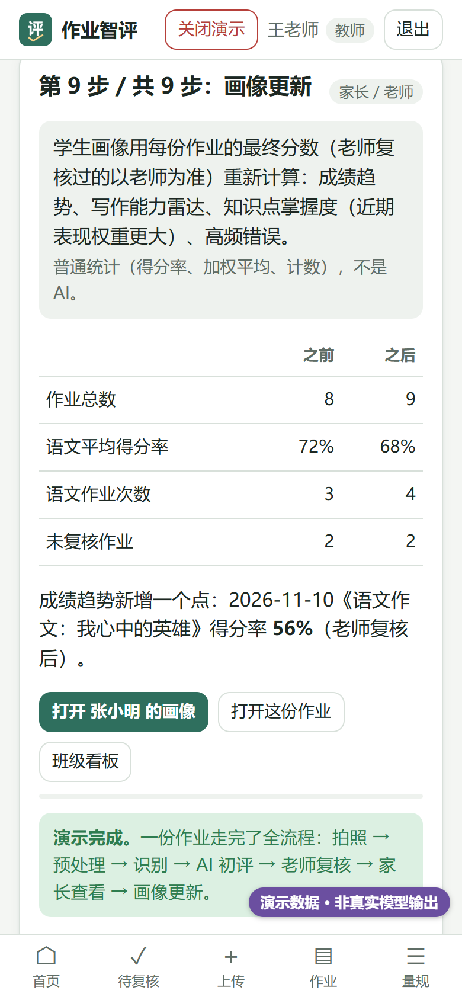

# 本机一键演示指南

> 不想安装：直接打开在线静态演示 <https://shuyaogao.github.io/homework-ai-grading-lab/>（回放录制好的合成数据，不能保存修改）。本页讲的是在自己电脑上运行完整版。

> **先说清楚**：演示里的一切都是**演示数据，非真实模型输出**。作业照片是程序合成的仿手写图；“识别”读取的是图片里内嵌的标准文本；评分是离线规则模拟（mock）；看板里的“教师复核”也是模拟的。页面顶部横幅和右下角紫色角标会一直提示这一点。
> 演示不联网、不调用任何付费接口。哪怕 `.env` 里填了 key，演示模式也会强制使用 mock。

## 1. 双击哪个文件

在项目文件夹（仓库根目录）里：

| 文件 | 作用 |
|---|---|
| **`启动演示.bat`** | 启动演示服务并自动打开浏览器。只允许本机访问 |
| `启动演示-手机可访问.bat` | 同上，但允许同一 WiFi 下的手机访问（第一次会弹 Windows 防火墙提示，选“允许专用网络”） |
| `停止演示.bat` | 关闭演示服务（也可以用页面右上角的“关闭演示”，或直接关掉黑色窗口） |

## 2. 会出现什么

1. 弹出一个黑色窗口，显示“正在启动……”。**第一次运行**要生成 71 张仿手写作业图片，约 1–2 分钟；以后几秒钟就好。
   **每次启动都会把演示数据恢复成初始状态**，上次演示时新增的作业会清掉。演示用的是单独的 `data\demo\` 文件夹（从种子快照 `data\demo_seed\` 复制），不会碰 `data\edu_eval.db` 里的正式数据。
2. 浏览器自动打开 `http://127.0.0.1:8000/#/demo`（8000 被占用时自动换成 8001、8002……，黑色窗口里会打印实际地址）。
3. 页面**自动以教师“王老师”的身份登录**，进入“作业智评 · 本机演示”首页，上面有 6 个入口：

   | 入口 | 内容 |
   |---|---|
   | ▶ 自动演示（约 1 分钟） | 家长拍照上传 → 预处理 → 识别 → AI 初评 → 教师复核改分 → 家长看到结果 → 画像更新，9 步自动进行，每步有说明 |
   | 班级看板 | 初二(3)班 12 名学生的分数分布、各维度得分率、共性问题、需要关注的学生、AI 与老师的一致性 |
   | 一份批改好的作文 | 张小明的语文作文，教师已复核：原图、识别文字、错误标注、分项得分 |
   | 待复核队列 / 学生画像 / 评分量规 | 对应的功能页 |

4. 黑色窗口要一直开着，它就是服务。演示结束后点页面右上角**“关闭演示”**，页面显示“演示服务已关闭”，黑色窗口里出现“演示服务已停止”，按任意键关掉即可。不会留下后台进程。

## 3. 演示顺序（约 8 分钟）

### 第一段：电脑端（5 分钟）

| 步骤 | 操作 | 讲什么 |
|---|---|---|
| 1 | 指着顶部紫色横幅和右下角角标 | “今天看到的全部是演示数据，分数不是大模型给的，是离线规则模拟的。真实模型还没接，原因后面讲。” |
| 2 | 点“▶ 自动演示”，然后放手 | “这是一份作业从拍照到画像的完整过程，系统会自己走一遍，大约 1 分钟。” |
| 3 | 第 1–3 步：家长登录、拍照、上传 | 孩子不满 14 周岁，监护人签了“基本同意”才能上传；没勾“云端 AI”就不会发给云端模型。上传时去掉照片里的 GPS 位置 |
| 4 | 第 4 步：图像预处理（左右对比图） | 用 OpenCV 找纸张四角做透视矫正、纠偏、去阴影。**这一步是传统图像算法，不是 AI** |
| 5 | 第 5 步：手写识别 | 真实部署用视觉大模型或 OCR；演示里直接读内嵌文本，所以“全对”。真实手写的准确率还没测 |
| 6 | 第 6 步：AI 初评 | 按量规逐项打分、标出错误、给评语和置信度；服务器会重算分数，拿不准的标“建议人工复核” |
| 7 | 第 7 步：教师复核改分（可点“暂停”多讲一会儿） | 老师改了一个维度并写理由；AI 原分保留，用来算 AI 与老师的一致性 |
| 8 | 第 8–9 步：家长看到结果、画像更新 | 家长只看到老师确认后的分数；画像随之更新 |
| 9 | 点“打开这份作业” | 原图/处理后切换、识别文字里的错误高亮（点一下看说明）、分项得分、复核历史 |
| 10 | 顶部“演示”→“班级看板” | 分数分布、共性问题、多人重复出现的错误、AI 与老师一致性表。**一致性数字来自模拟复核**，只说明功能 |

> 无人值守：打开 `http://127.0.0.1:8000/#/demo/auto?start=1&loop=1`，自动演示走完后 20 秒重新开始，可以放在展台上循环播放。

### 第二段：手机端（3 分钟）

**有真手机**：先关闭演示，双击 `启动演示-手机可访问.bat`。手机和电脑连同一个 WiFi（同一网段；访客网络往往和电脑不通），手机浏览器打开演示首页“手机端怎么看”里显示的地址，在登录页点“家长：parent_zhang”。

**没有手机**：在 Edge 里按 `F12`，再按 `Ctrl+Shift+M` 切到手机尺寸（选 iPhone 14 或 390×844），点右上角“退出”，再点“家长：parent_zhang”。

| 步骤 | 操作 | 讲什么 |
|---|---|---|
| 1 | 家长首页 | 孩子的同意状态；顶部同样有“演示数据”标注 |
| 2 | 底栏“作业记录” → 刚才自动演示上传的那份 | 状态“教师已复核”，看到的是老师的分数；看不到 AI 原始分和老师的内部备注 |
| 3 | 底栏“孩子” → 学习画像 | 成绩趋势、写作能力雷达、知识点掌握度、高频错误 |
| 4 | 底栏“拍照上传”（可选） | 选作业 → 拍照 → 自动弹出裁剪框 → 上传。真手机拍纸质作业时，mock 认不出内容，会返回示例文字并提示“不是真实识别结果”，正好说明演示和真实模型的区别 |
| 5 | 底栏“授权隐私” | 两档同意：基本同意、云端 AI 单独同意；可导出数据、撤回同意 |

## 4. 出问题怎么办

| 现象 | 处理 |
|---|---|
| 双击后提示“没有找到项目自带的 Python 环境 .venv” | 在项目文件夹打开 PowerShell，运行 `python -m venv .venv`，再运行 `.venv\Scripts\pip install -r requirements.txt` |
| 黑色窗口一闪就没了 / 报错 | 在项目文件夹打开 PowerShell，运行 `.venv\Scripts\python run.py --demo`，看具体报错 |
| 浏览器没有自动打开 | 手动打开黑色窗口里“演示首页”那一行的地址 |
| 提示“演示服务已经在运行” | 上次没关。直接用打开的页面，或先双击 `停止演示.bat` 再重新启动 |
| 页面显示“连不上演示服务” | 黑色窗口被关掉了，重新双击 `启动演示.bat` |
| 自动演示某一步报错 | 点“重新开始”；反复出错就关闭演示后重新启动 |
| 演示多次后数据太乱 | 关闭演示后重新双击 `启动演示.bat` 即可，每次启动都会恢复初始数据 |
| 想重新生成种子快照（例如改了种子数据代码） | 在 PowerShell 里运行 `.venv\Scripts\python run.py --demo --reset`（1–2 分钟） |
| 手机打不开 | 确认电脑和手机在同一网段（`ipconfig | findstr IPv4`）、手机连的是同一个 WiFi、防火墙允许了 Python 的专用网络访问 |
| 关不掉 / 担心有残留进程 | 双击 `停止演示.bat`：先请求服务正常退出，12 秒内没退出就结束进程树，最后会打印“没有遗留后台进程” |

## 5. 以后怎么切换到真实模型

演示模式（`run.py --demo`）**永远使用 mock**，这是故意的，保证演示不花钱。要用真实模型，用普通方式启动：

1. 把 `.env.example` 复制为 `.env`，填其中一项：
   - 服务器本地模型（推荐，数据不出校）：`OPENAI_COMPAT_BASE_URL=http://<服务器IP>:8101/v1`、`OPENAI_COMPAT_IS_LOCAL=true` 等，部署方法见 `docs/DEPLOY_LOCAL_MODEL.md`。
   - 通义：`DASHSCOPE_API_KEY=...`（云端、境内）。
   - Claude：`ANTHROPIC_API_KEY=...`（云端、境外，Anthropic 官方不在中国大陆提供服务）。
2. 先跑首轮评估，看费用和准确率：`.venv\Scripts\python scripts\first_real_eval.py --provider <vllm|dashscope|claude> --dry-run`，说明见 `scripts/first_real_eval.md`。付费接口去掉 `--dry-run` 后还要加 `--yes`。
3. 启动：`.venv\Scripts\python run.py`（不加 `--demo`）。顶部横幅从“演示数据，非真实模型输出”变回“AI 评分仅供参考”，就说明已经在用真实模型。
4. 云端模型只对监护人勾选了“云端 AI”的学生生效，其他学生自动降级为本地模型或 mock，结果页会写明原因。

## 6. 给维护者

- 演示相关代码：`run.py`（`--demo` / `--stop`）、`backend/routers/demo.py`（仅 `EDU_DEMO_MODE=1` 时开放）、`backend/demo/sample.py`（示例照片）、`backend/demo/lifecycle.py`（关闭服务）、`frontend/js/views/demo.js` 和 `demo_auto.js`。
- 关闭接口 `/api/demo/shutdown` 只接受本机请求，且必须带 `X-Demo-Action: shutdown` 请求头（别的网页无法跨站触发）。
- 测试：`tests/test_demo.py`（接口开关与权限、自动演示的完整接口流程、`run.py --demo` 启动后 `--stop` 不留进程）。
- 浏览器验收：`.venv\Scripts\python scripts\demo_check.py`（复制一份 `data\` 到临时目录再跑，不动你的演示数据；用本机 Edge 无头走完电脑端和手机端，截图写到 `demo/screenshots/`）。
