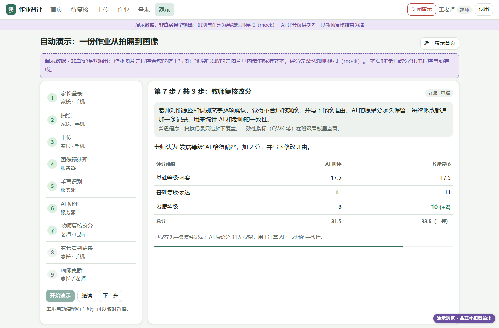

> **AI 教学演示案例 / AI Teaching Demos** 系列

# 作业智评：拍照批改作业的 AI 评价系统（教学演示）

**Shuyao Gao**（gaoshuyao.mk@gmail.com）· aSSIST University (Seoul School of Integrated Sciences and Technologies) · 서울과학종합대학원대학교
代码 MIT · 文档与教学素材 CC BY 4.0，使用请注明出处。

家长用手机拍下作业上传，服务器先把照片“摆正、擦干净”（OpenCV 透视矫正、纠偏、去阴影），再做手写识别，然后按 YAML 量规给出结构化评分：总分、分项分、在原文里标出的错误、评语、置信度、是否建议人工复核。老师复核改分（每次修改都留痕，AI 原分永久保留），系统据此更新学生画像和班级看板，并统计 AI 与老师的一致性。适合人工智能教育应用、教育测量、大模型应用开发、软件工程等课程拿来做课堂演示。

**AI 评分仅供参考，以教师复核结果为准。** 本仓库里的所有学生、作业和分数都是**程序合成的演示数据**；演示中的“识别”和“评分”是离线规则模拟（mock），**不是真实大模型的输出**。

**English summary.** *Homework AI Grading Lab* (作业智评) is a teaching demo of an AI-assisted homework assessment pipeline: a guardian photographs homework on a phone; the server corrects the photo with classical computer vision (OpenCV paper detection, perspective correction, deskew, shadow removal), recognises the handwriting, and grades it against a YAML rubric with schema-constrained structured output (criterion scores, located errors, comments, confidence, review flag); a teacher then reviews and adjusts the scores in an append-only audit trail, and student profiles, a class dashboard and AI-teacher agreement metrics (QWK / Pearson / MAE) are updated. It includes role-based access (teacher / guardian / student / admin), guardian-consent gating for minors and a cloud-vs-local model switch. Backend: FastAPI + SQLite; front end: vanilla JavaScript, no build step. **The online version is a static replay**: the same front end runs on GitHub Pages with a small JavaScript mock layer that replays responses recorded from the real backend on synthetic seed data; nothing is uploaded or saved. All data are synthetic and grading in the demo is an offline rule-based mock, not a real LLM. UI and documentation are in Chinese.



手机端流程动图（本机完整版，演示数据）：[showcase/assets/flow.gif](showcase/assets/flow.gif)

## 只想看看：打开网页就行

- **在线演示**：<https://shuyaogao.github.io/homework-ai-grading-lab/>（GitHub Pages，电脑和手机都能打开）。
  打开后自动以教师“王老师”的身份进入演示首页。点 **“▶ 自动演示（约 1 分钟）”**，9 步自动走完：家长登录 → 拍照 → 上传 → 图像预处理 → 手写识别 → AI 初评 → 教师复核改分 → 家长看到结果 → 画像更新，每一步都写明“这一步是不是 AI、用的是什么技术”。
- **产品展示页**：<https://shuyaogao.github.io/homework-ai-grading-lab/showcase/>（截图和流程说明，适合投影讲解）。

网页版是**静态演示**：页面顶部的横幅和右下角的角标一直写着“静态演示 · 合成数据”。它回放的是本机完整版在合成数据上录下的接口返回值，所以：

- 可以浏览所有页面：班级看板、待复核队列、批改结果（原图/处理后、错误高亮、分项分）、学生画像、量规、管理员的 provider 状态和审计日志；
- 自动演示里的“上传”和“老师改分”是录好的回放；
- 其他保存操作（手动上传、改分、改同意、保存量规）会提示“静态演示版不能保存修改”；
- 刷新页面就回到初始状态；关掉标签页就全部结束，不留下任何后台进程。

**怎么用（电脑）**：顶部导航切换页面；右上角“退出”回到登录页，登录页上有四个演示账号按钮（教师、家长、学生、管理员），点一下就能换角色。
**怎么用（手机）**：底部标签栏切换页面；想看家长端，点右上角“退出”，再点“家长：parent_zhang”。

| 角色 | 演示账号 | 看到什么 |
|---|---|---|
| 教师 | `teacher_wang` | 班级看板、待复核队列、复核改分、布置作业、量规 |
| 家长 | `parent_zhang` | 孩子张小明：拍照上传、批改结果、学习画像、授权与隐私 |
| 学生 | `student_zxm` | 自己的画像和作业 |
| 管理员 | `admin` | 模型 provider 状态、账号、数据保留清理、审计日志 |

演示班级“初二(3)班”有 12 名学生、7 次作业（英语作文 ×2、语文作文 ×2、数学 ×2、小论文 ×1），共 71 份提交；较早的 5 次作业模拟了教师复核；学生“刘洋”的监护人没有签署同意，用来演示合规闸门。这些都由 `backend/seed.py` 生成。

## 课堂上怎么用

1. 开场先指着顶部横幅说明：今天看到的全部是合成数据，分数不是大模型给的，是离线规则模拟的。
2. 放“自动演示”，让同学看一份作业从拍照到画像的完整过程。可以随时“暂停”，在“图像预处理”一步强调**这是传统图像算法，不是 AI**，在“教师复核改分”一步讨论“人在回路”。
3. 打开“一份批改好的作文”：原图/处理后切换、识别文字里的错误高亮、分项得分、复核历史。
4. 打开“班级看板”，看 AI 与老师的一致性表，讨论：一致性数字来自模拟复核，只说明功能；要评价真实模型，必须用真实数据重新评估（见下文）。
5. 讨论题：哪些步骤真正需要大模型？哪些普通程序就能做？给不满 14 周岁的学生用，需要哪些同意和保护措施（`docs/PRIVACY.md`）？

更详细的讲解顺序见 [DEMO_GUIDE.md](DEMO_GUIDE.md)（本机一键演示）和 [showcase/DEMO.md](showcase/DEMO.md)（现场演示脚本）。

## 它是怎么做的

```
手机拍照 ─► 上传（去 EXIF/GPS）─► 预处理 ─► 手写识别 ─► 量规评分 ─► 后处理校验 ─► 教师复核 ─► 画像 / 看板
                                  │          │           │            │              │
                          OpenCV 纸张检测  mock          mock(规则)   越界截断       逐项改分、批注、评语
                          透视矫正/纠偏    Claude 视觉   Claude       总分重算       修正识别文字后重评
                          去阴影增强       通义/vLLM     通义/vLLM    引文定位       每次修改留痕
                          多页拼接         PaddleOCR(可选)            定档 + 复核判断
```

- **评分结果 schema**（`backend/pipeline/grading/schema.py`）：模型只输出它需要判断的内容（分项分、错误原文、评语等）。错误在原文里的位置由服务端根据 `quote` 定位，分数截断到合法范围，总分由服务端重算，**不信任模型给的偏移量和总分**。
- **量规**（`backend/rubrics/*.yaml`）：内置 5 个（中考英语书面表达、高考英语应用文、高考作文、简答题/数学题、小论文），定义档次、评分维度、扣分项和复核策略；老师可以复制后修改。内置量规是参照公开评分原则整理的，**不是官方原文**。
- **合规闸门**：不满 14 周岁的学生必须有监护人“基本同意”才能上传；云端模型还需要单独的“云端 AI”同意，否则自动降级为本地模型或 mock，结果页写明降级原因。发给模型的内容不带学生姓名和学号。
- **一致性指标**（`backend/analytics/metrics.py`）：QWK、Pearson、MAE、±1 档。任一方方差为 0 时返回 null 并给出原因，不会悄悄返回 0 或 -1。

**规则基线有多弱**（数字来自 [eval/DATASETS.md](eval/DATASETS.md)，作者 2026-10-07 在本机用公开数据集离线跑出；数据集不随仓库分发）：mock 规则评分与人工分的 QWK 在 CFMS-34（中文作文）上是 0.271，而两位人类评分员之间是 0.569；在 ELLIPSE（英语作文）上线性映射是 0.052、线性校准后是 0.218。规则基线只能用来跑通流程，要得到有意义的自动评分必须接入大模型，并用同样的方法重新评估。**真实大模型和真实手写识别的准确率都还没有测过。**

## 想在自己电脑上运行完整版

需要 Python 3.12。完整版有真正的 FastAPI 后端：上传、识别、评分、复核改分都会真的执行（默认离线 mock，不联网、不花钱）。

```powershell
git clone https://github.com/ShuyaoGao/homework-ai-grading-lab.git
cd homework-ai-grading-lab
python -m venv .venv
.venv\Scripts\pip install -r requirements.txt
.venv\Scripts\python run.py --demo        # 本机一键演示：生成合成数据（第一次约 1–2 分钟）、强制 mock、自动打开浏览器
```

Windows 上也可以直接双击 **`启动演示.bat`**（`停止演示.bat` 关闭）。每次启动都会把演示数据恢复成初始状态。
不用演示模式时：`.venv\Scripts\python run.py --seed`，浏览器打开 <http://127.0.0.1:8000/>，API 文档在 <http://127.0.0.1:8000/api/docs>。
演示账号的密码见 `frontend/js/views/login.js`，**只用于本机演示，部署前务必修改或删除**。

**切换到真实模型**：把 `.env.example` 复制为 `.env`，填其中一项（密钥只写在 `.env`，不要提交进 git）：

| 想用 | 设置 | 说明 |
|---|---|---|
| Claude | `ANTHROPIC_API_KEY=...` | 默认 `claude-sonnet-5-5`，用结构化输出（JSON Schema）。属于云端、境外处理 |
| 通义（DashScope） | `DASHSCOPE_API_KEY=...` | 识别默认 `qwen-vl-max`，评分默认 `qwen-plus`。属于云端、境内处理 |
| 自己服务器上的本地模型 | `OPENAI_COMPAT_BASE_URL=http://<服务器IP>:8101/v1`，`OPENAI_COMPAT_IS_LOCAL=true` 等 | 用 vLLM 部署 Qwen-VL，见 [docs/DEPLOY_LOCAL_MODEL.md](docs/DEPLOY_LOCAL_MODEL.md) |

先跑首轮评估估算费用和准确率：`scripts/first_real_eval.md`。付费接口必须加 `--yes` 才会真的调用。

**验证**：

```powershell
.venv\Scripts\python -m pytest -q                 # 单元/接口测试（只用 mock，临时数据目录）
.venv\Scripts\python scripts\e2e_demo.py          # 真实启动服务跑全流程
```

**重新生成网页版**：`.venv\Scripts\python tools\static_demo\record.py` 用合成种子数据跑一遍真实后端，录下接口返回值和图片（输出到 `build/static_demo/`）；网页版 `play/` 就是 `frontend/` 加上 `play/mock/`（`mock.js` 接管 `/api/*` 请求，`data.js` 是录制结果）。

## 目录结构

| 目录 | 内容 |
|---|---|
| `play/` | 网页版（GitHub Pages）：`frontend/` 的副本 + `mock/` 静态回放层 |
| `backend/` | FastAPI 应用：`models.py`（SQLAlchemy 模型）、`routers/`（API）、`pipeline/`（预处理、OCR、评分 provider、量规）、`analytics/`（画像、看板、一致性指标）、`rubrics/`（内置量规）、`seed.py`（合成演示数据）、`demo/`（仿手写图片生成、本机演示） |
| `frontend/` | 原生 JS（ES modules）单页应用，没有构建步骤，由 FastAPI 托管；Chart.js 在 `vendor/` |
| `eval/` | 一致性评估：数据集调研 `DATASETS.md`、加载器、`run_eval.py`；`fixtures/` 是手工编造的格式样例 |
| `scripts/` | 端到端演示、仿手写测试图、浏览器冒烟测试、首轮真实评估 |
| `tools/static_demo/` | 网页版的录制脚本和接口模拟层 |
| `showcase/` | 产品展示页（`index.html`）、截图与流程动图、现场演示脚本 |
| `docs/` | `PRIVACY.md`（未成年人信息保护）、`DEPLOY_LOCAL_MODEL.md`（服务器部署本地模型） |
| `tests/` | pytest：鉴权、上传、流水线、schema、画像、复核、评估加载器、演示接口 |

## 常见问题

- **网页版的分数是大模型打的吗？** 不是。全部是离线规则模拟（mock）在合成数据上的结果，界面上一直有标注。
- **能上传自己的作业试试吗？** 网页版不能（没有后端，也不应该把学生作业传到公开网站）。在本机运行完整版可以上传，但 mock 认不出真实照片的内容，会返回示例文字并提示“不是真实识别结果”。
- **关掉网页后还有东西在运行吗？** 没有。网页版是纯静态页面，关掉标签页就全部结束，不留后台进程；也不保存任何数据（只在浏览器里记住登录的演示账号）。本机完整版用页面右上角“关闭演示”或 `停止演示.bat` 退出。
- **合规上还缺什么？** HTTPS、静态加密、个人信息保护影响评估等上线前必须补做的事项，见 `docs/PRIVACY.md`。

## 许可证与引用

- 代码：MIT（`LICENSE`）。
- 文档与教学素材（README、docs/、截图、合成作业图片、页面上的讲解文字等）：CC BY 4.0（`LICENSE-docs`）。
- 第三方组件（Chart.js）和数据说明：`THIRD_PARTY.md`。
- 引用：见 `CITATION.cff`。

## AI 辅助开发声明

本项目的代码和文档由 Claude Code（Anthropic）辅助编写，经作者审阅。
